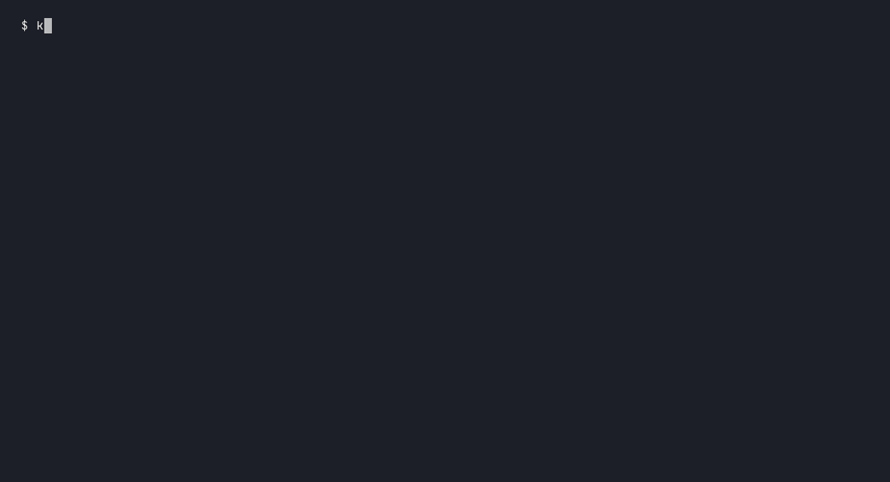

# KeyLeak Detector

**Find the API keys and open Supabase/Firebase tables your running app actually ships.**

[](https://pypi.org/project/keyleak-detector/)
[](https://github.com/Amal-David/keyleak-detector/blob/main/LICENSE)
[](https://github.com/Amal-David/keyleak-detector)

Static scanners read your source. KeyLeak watches the running app (traffic, JS bundles, headers) and tests whether your backend is readable with the public key. You get a verdict, redacted evidence, fix steps, and a re-test command. Reports stay on your machine. Website: [keyleakdetector.com](https://keyleakdetector.com)



> Only scan apps you own or are authorized to test. Probes are read-only. Reports redact credential values.

## Try it

- **Chrome extension** (browse your app, see findings as pages load): [Chrome Web Store](https://chromewebstore.google.com/detail/keyleak-detector/ildodbfchnbmndkcijllpmihcbfchgdl)
- **CLI** (Python 3.12 or newer required; older Pythons install the outdated 0.5.0 release):

  ```bash
  pip install keyleak-detector
  keyleak local . --launch-profile launch-gate --fail-on high
  python -m playwright install chromium   # once, for browser scans
  keyleak browser-scan https://your-owned-app.example --baas-validate
  ```

- **Browser app** (scans pasted text and files on your device, no Python): [build and serve it locally](https://github.com/Amal-David/keyleak-detector/blob/main/docs/BROWSER_APP.md).

## Example result

`keyleak local . --launch-profile launch-gate --fail-on high` on a copy of the repository's fake-key fixture (`fixtures/vulnerable-demo`), trimmed:

```text
BLOCK SHIP: 4 critical, 1 high, 4 medium, 1 low
5 high/critical exposure(s); static detections — verify before relying on them. Fix before release.
Re-test: keyleak local /private/tmp/acme-app --include ci,code,config,docker,env,logs,mcp,sourcemaps --launch-profile launch-gate --packs leak --fail-on high
Coverage: complete; 3/3 checks completed; 0 skipped, 0 failed.
- CRITICAL openai_api_key at /private/tmp/acme-app/.env.leaky: [redacted:8003d7c8]
- CRITICAL database_url at /private/tmp/acme-app/.env.leaky: [redacted:a15e8e37]
- CRITICAL openrouter_api_key at /private/tmp/acme-app/app.js.map: [redacted:f21e9200]
- HIGH mcp_config_secret at /private/tmp/acme-app/.env.leaky: [redacted:540d08fb]
...
```

Add `--markdown`, `--html`, `--json`, or `--sarif` for the full report. Each finding carries its fix:

```text
### CRITICAL: openai_api_key
- Source: `/private/tmp/acme-app/.env.leaky`
- Evidence: `[redacted:9162cc36]`
- Fix steps:
    1. Rotate the OpenAI key, remove it from client/config files, and load it server-side from a secret manager.
```

The command exits `2` when findings reach `--fail-on` or coverage is incomplete.

## Why not just gitleaks or trufflehog

- The secrets that hurt are the ones users receive: injected at build time, served in bundles, or exposed by a backend with RLS off.
- Source scanners read the repository, so they miss what only exists in the built or running app.
- Use KeyLeak next to your source scanner, not instead of it.

## What it detects

- API credentials, private keys, and JWT risks in browser responses, JS bundles, source maps, and local files.
- Supabase, Firebase, Appwrite, PocketBase, and Convex configuration or access-control issues.
- Risky npm lifecycle hooks, CI workflow settings, and exposed local configuration.
- Opt-in application-security leads, labeled for review when they are not validated exploits.

## Safe use

- Scan only systems you own or have permission to test.
- `--baas-validate` sends active read-only probes to the Supabase/Firebase project the app uses, with the key found in the app; leave it off unless you are authorized.
- Apart from that, detected keys are never sent to their provider to check whether they are live. Details: [security model](https://github.com/Amal-David/keyleak-detector/blob/main/docs/SECURITY_MODEL.md).

## CI

```yaml
- uses: actions/checkout@v4
- uses: Amal-David/keyleak-detector@v0.8.0
  with:
    mode: local
    fail-on: high
```

Browser mode, SARIF upload, and preview-deployment examples: [GitHub Action guide](https://github.com/Amal-David/keyleak-detector/blob/main/docs/github-action.md).

## More

- [Scanner workflows](https://github.com/Amal-David/keyleak-detector/blob/main/docs/SCANNER_WORKFLOWS.md): every command, coverage options, verdicts, exit codes
- [Chrome extension](https://github.com/Amal-David/keyleak-detector/blob/main/docs/CHROME_EXTENSION.md): unpacked ZIP, native host, permissions
- [Browser app](https://github.com/Amal-David/keyleak-detector/blob/main/docs/BROWSER_APP.md)
- [Binary and archive scanning](https://github.com/Amal-David/keyleak-detector/blob/main/docs/BINARY_ARTIFACT_SCANNING.md)
- [Agent runbook and skills](https://github.com/Amal-David/keyleak-detector/blob/main/docs/AGENT_SCAN_HOWTO.md) and [integration audit](https://github.com/Amal-David/keyleak-detector/blob/main/docs/AGENT_INTEGRATION_AUDIT.md)
- [Python secret serialization review](https://github.com/Amal-David/keyleak-detector/blob/main/docs/SERIALIZATION_REVIEW.md)
- [PHP patch assessment and incident checks](https://github.com/Amal-David/keyleak-detector/blob/main/docs/OCTOBER_2026_INCIDENTS.md)
- [Convex support](https://github.com/Amal-David/keyleak-detector/blob/main/docs/CONVEX_SUPPORT.md)
- [Releases and packaging](https://github.com/Amal-David/keyleak-detector/blob/main/docs/DISTRIBUTION.md) and [changelog](https://github.com/Amal-David/keyleak-detector/blob/main/CHANGELOG.md)

## Contributing, security, license

See [CONTRIBUTING.md](https://github.com/Amal-David/keyleak-detector/blob/main/CONTRIBUTING.md) to set up a checkout and add detectors. Report vulnerabilities privately through [SECURITY.md](https://github.com/Amal-David/keyleak-detector/blob/main/SECURITY.md); review ownership is in [MAINTAINERS.md](https://github.com/Amal-David/keyleak-detector/blob/main/MAINTAINERS.md). MIT licensed: [LICENSE](https://github.com/Amal-David/keyleak-detector/blob/main/LICENSE).
